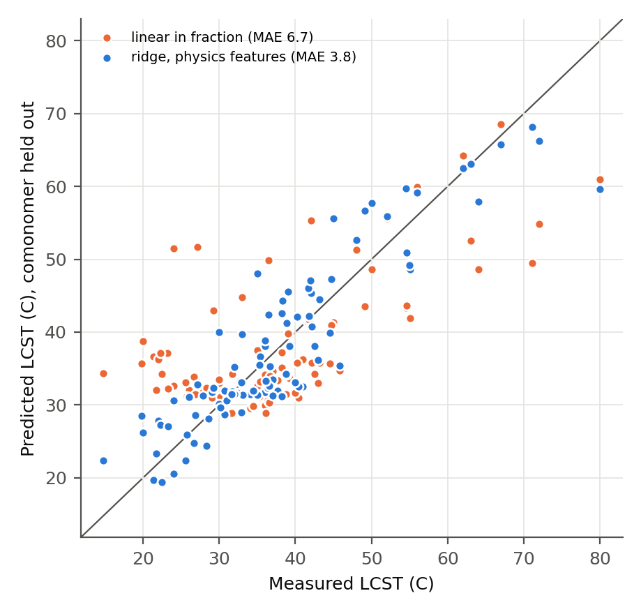

>

# Predicting the LCST of NIPAM copolymers

PNIPAM is dissolved in cold water and becomes cloudy at about 32 C. This temperature can be shifted by copolymerising NIPAM with a second monomer, and this effect is used in the smart nanofibers developed in Mitsuhiro Ebara's group at NIMS. In those fibers, NIPAM is copolymerised with N-hydroxymethylacrylamide (HMAAm) so that the switch is raised to the mild-hyperthermia range, around 42 to 45 C.

In this project, the question of how well that temperature can be predicted from the structure of the comonomer and its amount in the chain was studied. Published LCSTs for NIPAM copolymers were collected, each comonomer was described with a small number of descriptors, and the model was tested on comonomers that were not seen during training, including the HMAAm copolymers reported by the Ebara group.

## Main result

It was found that a ridge regression on the mole fraction and three fraction-weighted features (the change in logP, polar surface area, and H-bond donors of the comonomer relative to NIPAM), together with the polymer concentration and a buffer flag, predicted the LCST of held-out comonomers with a mean absolute error of 4.3 C. For comparison, an error of 8.9 C was obtained when 32 C was predicted for every copolymer, and an error of 6.6 C was obtained with a straight line in mole fraction.

For the Ebara group's HMAAm copolymers, all HMAAm rows were removed from training before the prediction was made. An error of 2.6 C was obtained across 7 measurements, and all 7 values were found inside the 90% prediction interval. The predictions were about 3 to 4 C too high near 20 mol% HMAAm.

No improvement was obtained with the 4215 alvaDesc descriptors. These models appeared accurate under random cross-validation but failed when new comonomers were predicted.



## How to run

Python 3.13 was used (Python 3.11 was specified in the spec but was not available; the change is recorded in the changelog in `SPEC.md`).

```bash
pip install -r requirements.txt
bash run.sh
```

The stages 1 to 7 are run in order by `run.sh`, and the whole analysis is rebuilt from `data/raw/` in about 7 minutes. Most of this time is taken by Stage 4.

## What each stage does

| Script | What is done | What is written |
|---|---|---|
| `src/s1_comonomers.py` | the dataset schema is checked; every comonomer SMILES is parsed and drawn | `data/processed/comonomers.csv`, `results/figures/comonomer_structures.png` |
| `src/s2_descriptors.py` | RDKit descriptors and fraction-weighted features are computed; the alvaDesc export is read | `data/processed/model_table.csv`, `descriptors_rdkit.csv`, `descriptors_alvadesc.csv` |
| `src/s3_clean.py` | missing, constant, near-constant, and correlated descriptors are removed (4226 to 470) | `data/processed/features_clean.csv`, `results/feature_cleaning.csv` |
| `src/s4_model.py` | baselines, ridge, random forest, and boosting are trained; random 5-fold, grouped 5-fold, and leave-one-comonomer-out validation are applied | `results/metrics.csv`, `results/predictions_logo.csv` |
| `src/s5_trends.py` | the logP trend at fixed fraction, the composition series, and the coefficients are examined | `results/trend*.csv`, `results/coefficients_ridge_physics.csv`, figures |
| `src/s6_ebara_predict.py` | the Ebara HMAAm check is run with HMAAm held out; new copolymers are predicted with an applicability-domain check | `results/ebara_check.csv`, `results/new_predictions.csv`, `results/applicability_domain.csv`, figures |
| `src/s7_summary_figures.py` | the summary and dataset-overview figures are drawn | `results/figures/results_summary.png`, `results/figures/dataset_overview.png` |

## Folder guide

```
data/raw/          lcst.csv (the dataset), alvadesc_export.txt (the raw descriptor export)
data/processed/    comonomers, descriptors, model table, cleaned features
data/sources.md    all sources, what was taken from each, and what was left out and why
data/pdfs/         paper PDFs used for extraction (git-ignored, not included in the repo)
results/           metrics, predictions, trend tables, figures/
notes/             research_note.tex and research_note.md
README.tex         LaTeX version of this file (pdflatex README.tex)
SPEC.md            the spec that was followed, and the changelog
```

## Notes on the data

- There are 113 training rows from 22 sources, covering 22 comonomers and 16 PNIPAM reference rows. A further 7 rows from four Ebara group papers are kept in the same file with `role = ebara_check` and were not used for training.
- Most rows were taken from tables. 9 rows were read from figures (`read_method = digitized_from_figure`), with an accuracy of about 1 C.
- 19 rows are values that were compiled from the literature in another paper (Hayakawa et al. 2023, ESI). The measurement method, and whether the fraction refers to the feed or the measured composition, are not given there, so these rows are marked with a `secondary` note.
- LCST is measured in different ways in different papers (50% transmittance, first visible turbidity, absorbance thresholds, DSC). The method was recorded for every row. This adds a few degrees of noise that cannot be removed by the model.
- The LCST of charged comonomers (acrylic acid and two amine monomers) changes with pH, so these were left out of the headline numbers. Results with them included are given in `metrics.csv` under `subset = all`.

## Known limitations

- 22 comonomers is a small number, and 18 of them were taken from a single paper each.
- The same Crippen logP is given to N-n-propylacrylamide and NIPAM, although the homopolymer of N-n-propylacrylamide switches about 10 C lower. This kind of difference is not captured by simple 2D descriptors.
- A negative coefficient was obtained for the TPSA term. Because this term is strongly correlated with the logP term (r = -0.74), the individual coefficients should not be interpreted as separate physical effects.
