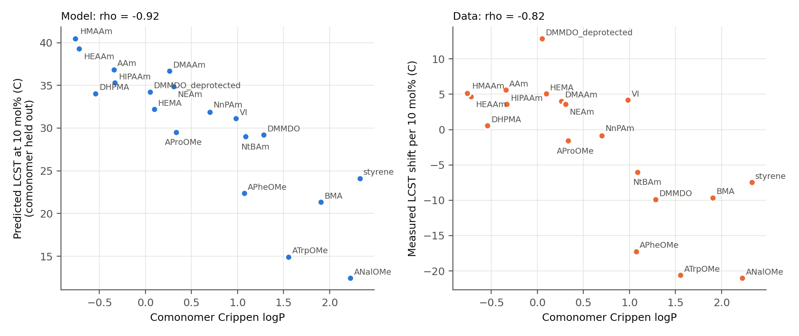
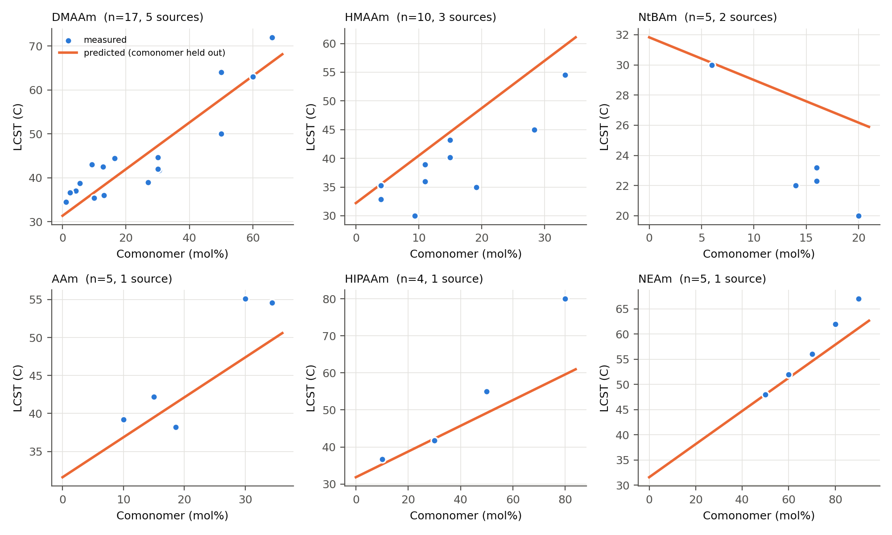
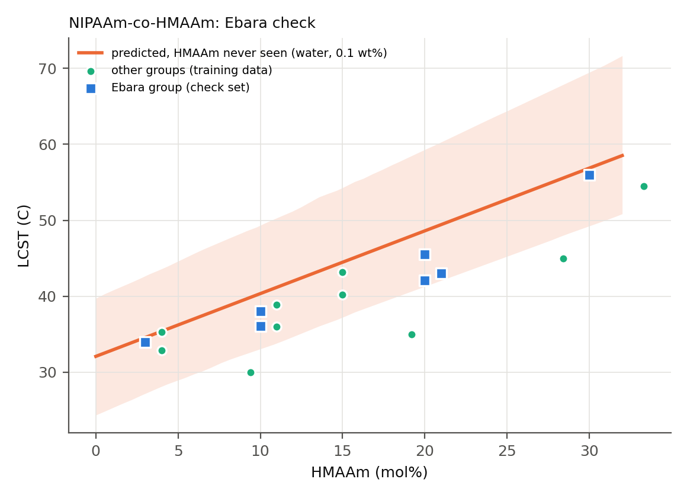
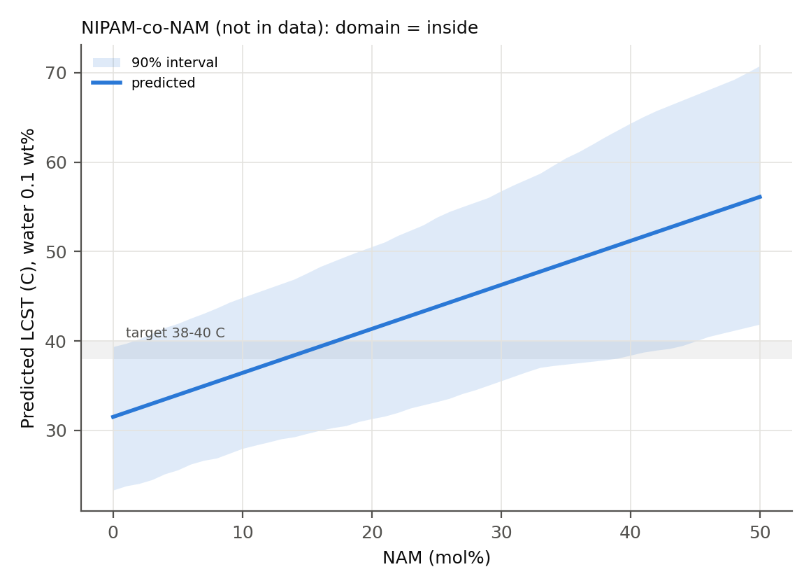

# Predicting the LCST of NIPAM copolymers from comonomer structure

## Introduction

The temperature-responsive nanofibers developed in the Ebara group at NIMS are made from NIPAM copolymerised with N-hydroxymethylacrylamide (HMAAm). Two roles are played by the HMAAm. Its hydroxyl groups are used to crosslink the fibers when they are heated, and because it is more hydrophilic than NIPAM, the LCST is raised from about 32 C to the temperature required by the application. For magnetic hyperthermia, this is around 42 to 45 C. The choice of comonomer and of its amount is therefore the central design decision.

In this project, the following question was investigated: given the structure of a comonomer and its mole fraction in the chain, how well can the LCST be predicted, and does the prediction still hold for a comonomer that was not seen during training?

## Data

A single table of published LCSTs for random NIPAM copolymers in water or buffer was built (`data/raw/lcst.csv`). The final table contains 113 training rows from 22 papers. These cover 22 comonomers, ranging from strongly hydrophilic (acrylamide, HMAAm, hydroxyethylacrylamide) to strongly hydrophobic (butyl methacrylate, styrene, aromatic amino-acid acrylamides). The measured LCSTs range from 15 to 80 C.

Several problems with the data were kept in mind throughout.

1. LCST was measured in at least five different ways. In some papers, the temperature at 50% transmittance was reported, while in others the first sign of turbidity, an absorbance threshold, or a DSC peak was used. These values can differ by a few degrees for the same polymer. The method was recorded for every row, but no correction was applied.
2. In some papers the monomer feed was reported, and in others the measured composition was reported. For free-radical copolymers these are usually close, but not always.
3. 18 of the 22 comonomers were taken from a single paper each, and 19 rows are values that were compiled from the literature by another group without the measurement method being stated.
4. The LCST of charged comonomers depends on pH. For this reason, acrylic acid and the two amine comonomers were left out of the headline analysis.

After these were removed, the main set contained 103 rows and 19 comonomers.

The HMAAm copolymers reported by the Ebara group (seven values from four papers) were placed in a separate check set and were not used for training.

## Method

RDKit descriptors were calculated for each comonomer, and alvaDesc was also used, which gives 4215 descriptors. The feature that was expected to matter most was a simple one: the mole fraction multiplied by the difference between the logP of the comonomer and that of NIPAM. The addition of 10% of a comonomer that is much more hydrophobic than NIPAM is expected to lower the LCST, and the addition of a more hydrophilic comonomer is expected to raise it. The same construction was applied to polar surface area (TPSA) and to the number of H-bond donors. The polymer concentration and a flag for buffer solutions were also included, and the models were fitted with the mole fraction itself as a further feature.

Every model was required to beat two baselines: a prediction of 32 C for every copolymer, and a straight line in mole fraction that ignores which comonomer is present.

Particular attention was paid to validation. If one comonomer appears at five compositions and the data are split randomly, that comonomer is seen by the model during training, and only interpolation is required. This does not answer the question that was asked. For this reason, random 5-fold cross-validation was reported alongside grouped 5-fold cross-validation, in which all rows of a comonomer are held out together, and alongside leave-one-comonomer-out validation. The grouped result was taken as the main result.

## Results

### Random versus grouped validation

| Model | Random 5-fold MAE (C) | Grouped 5-fold MAE (C) |
|---|---|---|
| 32 C for everything | 8.9 | 8.9 |
| Linear in mole fraction | 6.2 | 6.6 |
| Ridge, fraction x (logP, TPSA, HBD difference) | 3.6 | 4.3 |
| Random forest, 8 RDKit descriptors | 4.0 | 5.0 |
| Ridge, all 8 RDKit descriptors | 3.8 | 6.8 |
| Ridge, top 10 alvaDesc descriptors (selected inside each fold) | 4.5 | 20.8 |

Under random splits, almost every model appeared accurate, with errors between 3.6 and 4.5 C. Under grouped splits, the models were clearly separated. The error of the small ridge model on the fraction-weighted features increased by only 0.7 C. In contrast, the error of the alvaDesc ridge model increased from 4.5 to 20.8 C. It was found that this model had learned the comonomers it was trained on and gave extreme predictions for new ones; the largest errors (22 to 32 C in leave-one-comonomer-out validation) were obtained for HIPAAm, DHPMA, styrene, and N-tert-butylacrylamide. It had been expected that the large descriptor set would improve the predictions, but this was not the case.

With the fraction multiplied by logP alone, the mole-fraction baseline was beaten by only about half a degree. When polar surface area and H-bond donors were added, the error was reduced from 6.0 to 4.3 C.

### Reproduction of the known trends

It is reported in the literature that hydrophobic comonomers lower the LCST and hydrophilic comonomers raise it. This was confirmed in the collected data: for each comonomer, the LCST shift per 10 mol% was fitted, and it was found to decrease with logP (Spearman rho = -0.82 over 19 comonomers). When each comonomer was predicted at 10 mol% with that comonomer held out, the same order was obtained from the model (rho = -0.92).

For the composition dependence, the held-out predictions were compared with the measured series. For DMAAm (17 rows from 5 papers), a shift of 5.1 C per 10 mol% was predicted, which is the same as the measured value. For N-ethylacrylamide, 3.9 C was predicted against 3.6 C measured. The direction was correct for all six series that were examined, but the size of the shift was underestimated for N-tert-butylacrylamide and HIPAAm and overestimated for HMAAm (8.1 against 5.1 C per 10 mol%).

One result was found that does not fit the textbook picture. A negative coefficient was obtained for polar surface area, which, if read on its own, would mean that a larger polar surface lowers the LCST. This result was stable (the same sign was obtained in 99% of bootstrap refits in which the comonomers were resampled) and was not caused by the bulky aromatic comonomers. It is thought that this term acts as a correction to the logP term, since the two fraction-weighted features are correlated with r = -0.74, and a single hydrophilicity effect is therefore divided between them. When TPSA was removed, the grouped error increased from 4.3 to 7.2 C, so the term is useful for prediction, but the coefficients should not be interpreted one by one.

### The Ebara check

All HMAAm rows were removed from training, so that HMAAm had not been seen by the model, and the seven values reported by the Ebara group were then predicted.

A mean error of 2.6 C was obtained, compared with 5.8 C for the mole-fraction baseline and 10.1 C for a prediction of 32 C. All seven measured values were found inside the 90% prediction interval. The copolymer with 30 mol% HMAAm in water, which was measured at 56.0 C, was predicted at 56.9 C. Near 20 mol% HMAAm, the predictions were 3 to 4 C too high, mostly for the measurements made in PBS.

This difference is partly a result of the spread in the published HMAAm data rather than of the model. Across the papers that were used, the LCST increase per 10 mol% HMAAm ranges from about 3 to 7 C, which is expected given the differences in measurement method, concentration, and molecular weight. When the HMAAm data from the other groups were added back into training, the error was reduced only from 2.6 to 2.1 C.

### A new prediction

The model was then used to find a comonomer, not included in the data, that would place the transition at 38 to 40 C, just above body temperature.

It is predicted that this is achieved with N-acryloylmorpholine (NAM) at 14 to 17 mol% (in water, 0.1 wt%). At 20 mol%, an LCST of 41 C is predicted, with a 90% interval of 31 to 50 C.

The logP, polar surface area, and H-bond donor count of NAM all lie within the range of the training comonomers, and its leverage is 0.29 compared with a threshold of 0.63. Therefore, NAM is considered to be inside the applicability domain of the model in terms of its descriptors. However, it is structurally new, since the fingerprint similarity to the nearest training comonomer is only 0.31. The prediction should therefore be regarded as lying within the descriptor range but for a chemistry that is not covered by the data.

N-(2-hydroxypropyl)methacrylamide (HPMA) was considered first, because it is hydrophilic and carries a hydroxyl group like HMAAm. However, almost no change in LCST was predicted for HPMA. When the individual terms were examined, it was found that its logP contribution (+10.7 C at 20 mol%) is cancelled by its TPSA contribution (-9.7 C), which is the correlated term discussed above. For NAM, the prediction comes almost entirely from the logP term, so NAM was chosen instead.

## Limitations

- 22 comonomers is a small set, and the headline error of 4.3 C is based on 19 of them.
- A few degrees of noise are added by the mixed measurement methods, and this cannot be explained by any descriptor.
- Molecular weight and end groups are known to affect the LCST, especially for short chains, but molecular weight was missing for about half of the rows and could not be used.
- Isomers cannot be separated by two-dimensional descriptors. The same logP is given to N-n-propylacrylamide and NIPAM, even though the homopolymer of N-n-propylacrylamide switches about 10 C lower.
- The model is linear in mole fraction. This is adequate up to about 30 mol% for most comonomers, but curvature is seen in the measured data at higher fractions.

## Future work

The most direct test would be the synthesis of NIPAM-co-NAM at around 15 mol%, followed by measurement of its cloud point by UV-vis spectroscopy with a temperature ramp, to determine whether the transition lies at 38 to 40 C. It would also be of interest to study how the HMAAm content and crosslinking affect the transition once the polymer is electrospun into fibers, since the solution LCST is only the first step for the systems developed in the Ebara group.
